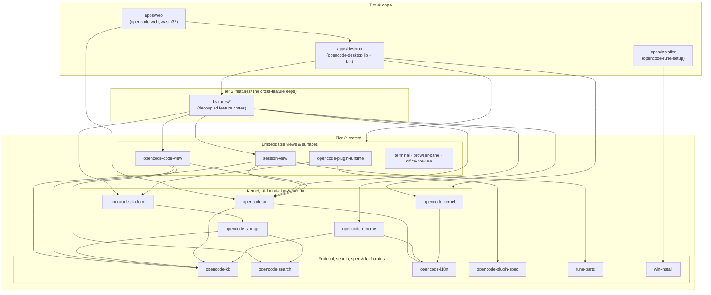

# Architecture

`rune-desktop` uses **progressive disclosure** in its folder layout so contributors and agents can ship features without navigating core internals.

## 1. Progressive-Disclosure Layout

Start at the top and go deeper only when a feature needs lower-level control. Every workspace member in the root `Cargo.toml` (plus the excluded `apps/browser-engine` sidecar) is listed once below.

### Tier 1: `plugins/`

Built-in `--!strict` Luau plugins targeting `opencode-plugin-spec` (`contract.json`), hot-reloaded in place without Rust compiles. `apps/desktop/build.rs` embeds every `plugins/<id>/` directory containing a `plugin.toml` into the binary as precompiled bytecode; non-headless debug builds load and watch the repository's `plugins/` folders directly. See [`crates/opencode-plugin-spec/docs/writing-a-plugin.md`](crates/opencode-plugin-spec/docs/writing-a-plugin.md).

### Tier 2: `features/`

Decoupled Rust feature crates in a flat, parallel layer with zero cross-feature dependencies. Entrypoints use concrete types or object-safe `&dyn *Host` / `&mut dyn *Host` boundaries (keeping thin generic `H: *Host + 'static` wrappers only at `rune::El` / `Tx` callback edges).

| Path | Crate | Scope |
| --- | --- | --- |
| `features/annotations` | `opencode-feature-annotations` | Timeline/terminal quote toolbar, composer comment cards, floating quote-comment editor, and code/diff line comments |
| `features/composer-input` | `opencode-feature-composer-input` | Composer attachments, remote upload runner/toast, file dropzone overlay, suggestions state machine, history popover, slash commands, and prompt history |
| `features/connect` | `opencode-feature-connect` | Provider and integration connect dialog, catalog sync, picker catalog reads, and ChatGPT plan welcome |
| `features/dictation` | `opencode-feature-dictation` | Hex voice dictation state machine, presence watcher, and composer toolbar controls |
| `features/egg` | `opencode-feature-egg` | New-session wordmark Easter egg (lodger, 3D pin board, Brick Breaker, synthesized sounds; GPU/FFI unsafe allowlisted) |
| `features/files` | `opencode-feature-files` | Workspace file tree, file viewer, Markdown/HTML/table/Mermaid/image/video previews, inline-code link resolution, and file watcher |
| `features/find` | `opencode-feature-find` | Session timeline Find (`Cmd/Ctrl+F`) state machine, incremental transcript search index, match highlighting, and find bar |
| `features/history` | `opencode-feature-history` | Session timeline message navigation, Jump to message dialog, Rewind (`/undo`, `/redo`), and Fork from message dialog |
| `features/inbox` | `opencode-feature-inbox` | Session prompt queue strip, drag/edit/rewrite state machines, durable prompt outbox, and delivery receipt checks |
| `features/mcp` | `opencode-feature-mcp` | MCP server toggle state machine, MCPs dialog, and browser OAuth sign-in dialog |
| `features/mentions` | `opencode-feature-mentions` | Composer `@` mentions popover, search state machine, badges, session chips, and wire encoding |
| `features/narrow` | `opencode-feature-narrow` | Narrow-window (`< 768` px) layout mode, view switcher, tabs/More drawers, and draggable sheets |
| `features/notifications` | `opencode-feature-notifications` | System notifications, actionable permission/question toasts, coordinator, and activation helpers |
| `features/office` | `opencode-feature-office` | Word, Excel, and PowerPoint Vello preview engine, worker threads, and spreadsheet grid (optional `office` feature; GPU unsafe allowlisted) |
| `features/open-in` | `opencode-feature-open-in` | External editor/terminal detection, launching, preferred app persistence, and URL opening (OS FFI unsafe allowlisted) |
| `features/panels` | `opencode-feature-panels` | Session side, split, and bottom panel strip, drag/resize/closing state machines, launchers, menus, and persistence |
| `features/projects` | `opencode-feature-projects` | Project tracking, Home across servers, session JSON import, sidebar organize/customize/recent state, and remote directory picker dialog |
| `features/restore` | `opencode-feature-restore` | Window state restoration, composer drafts, blob attachments, timeline places, boot previews, offline transcript copies, and draft undo persistence |
| `features/review` | `opencode-feature-review` | Review changes engine, untracked folder loader, narrow Changes view, focus anchoring, and shared file-panel chrome |
| `features/session-menu` | `opencode-feature-session-menu` | Session right-click context menus, inline and dialog rename, undoable delete, export, and read/mute/hide preferences |
| `features/settings` | `opencode-feature-settings` | Settings two-pane shell, preferences persistence, search index, and built-in settings pages |
| `features/subagents` | `opencode-feature-subagents` | Running-work activity capsule, background shells state machine and output followers, and subagent reply bar |
| `features/switcher` | `opencode-feature-switcher` | Command/file/session palette switcher, shared session search index, and project/worktree/branch switcher |
| `features/terminal-surface` | `opencode-feature-terminal-surface` | Ghostty-VT terminal pane, workspace tabs, persistence, shell integration, inline rename, find, links, and paste guard |
| `features/timeline-extras` | `opencode-feature-timeline-extras` | Agent todo pill/list, permission/question reply state machines, live subagent step rows, auto-accept, and timeline capture helpers |
| `features/tips` | `opencode-feature-tips` | Paced one-time onboarding tip queue state machine and persistence |
| `features/updater` | `opencode-feature-updater` | Release feed, verification, and platform update engine for macOS, Windows, and Linux (OS FFI unsafe allowlisted) |
| `features/usage` | `opencode-feature-usage` | Usage limits parser, Usage dialog, OpenCode Go meters, Console budgets, and picker budget warnings |
| `features/workspace-tools` | `opencode-feature-workspace-tools` | New-worktree branch picker, per-folder `rune` client MCP hub, Home session search, and local SQLite full-text message search |

### Tier 3: `crates/`

Shell kernel, UI foundation, headless runtime, platform utilities, and embeddable libraries shared with `anomalyco/seer` and other Rune apps.

| Path | Crate | Scope |
| --- | --- | --- |
| `crates/authenticode` | `authenticode` | Windows Authenticode verification (`WinVerifyTrust`) and signer lookup for the updater and browser engine |
| `crates/browser-pane` | `browser-pane` | Pure-Rust Rune client for the on-demand `OpenCode Browser Engine` CEF sidecar (behind the `engine` feature) |
| `crates/hex-client` | `hex-client` | Local HTTP/capture client for driving Hex voice dictation |
| `crates/office-preview` | `office-preview` | Read-only Word, Excel, and PowerPoint layout and Vello display-list engine over BetterOffice |
| `crates/opencode-code-view` | `opencode-code-view` | Virtualized syntax-highlighted code and diff viewers plus review, delimited table, and label-find data models (built on `opencode-ui`, zero `session-view` dependency) |
| `crates/opencode-i18n` | `opencode-i18n` | Desktop message catalogs and Rune strings with compile-time validated keys (`t!`, `plural!`, locale date/number formatting) |
| `crates/opencode-kernel` | `opencode-kernel` | Shell kernel registries (`StateSlots`, `OverlayStack`/`OverlayDispatcher`, `LifecycleScheduler`, `CommandRegistry`, `EventBus`, `SurfaceRegistry`), shared host traits (`AppEnv`, `AppFeedback`, `AppOverlays`), and `Feature<S>` (`#![forbid(unsafe_code)]`) |
| `crates/opencode-kit` | `opencode-kit` | Reusable OpenCode HTTP/SSE/WS client, local `service.json` discovery, and session/transcript model (free of app-specific concepts) |
| `crates/opencode-platform` | `opencode-platform` | OS and WASM host utilities: `wall`, `telemetry`, `askpass`, `web_fetch`, `host` (`PlatformPaths`/`PlatformInfo`), and `storage` (`StoragePort`) (`#![forbid(unsafe_code)]`) |
| `crates/opencode-plugin-runtime` | `opencode-plugin-runtime` | `App`-independent Luau plugin runtime primitives (`catalogs`, `console`, `flyout`, `hot`, `icons`, `images`, `luau`, `machines`, `native_icons`, `power`, `process`, `qr`, `redraw`, `reveal`, `sources`, `tasks`) |
| `crates/opencode-plugin-spec` | `opencode-plugin-spec` | Engine-agnostic plugin contract (`contract.json`), Luau/JSON-schema/Rust codegen, and host decoders |
| `crates/opencode-runtime` | `opencode-runtime` | Headless runtime primitives and explicit state machines (`catalog`, `draft`, `idle`, `pairing`, `server_machine`, `server_pool`, `window`, `types`, and `machines/{fork,pages,queue,rewind,send_failed,send_reason}`) (`#![forbid(unsafe_code)]`) |
| `crates/opencode-search` | `opencode-search` | Headless full-text, fuzzysort, path index, file ranking, tokenizer, and URL query primitives (`#![forbid(unsafe_code)]`, zero Rune/UI deps) |
| `crates/opencode-storage` | `opencode-storage` | Persistence engine: SQLite with write-behind and draft journal on native; `localStorage`/IndexedDB on `wasm32` |
| `crates/opencode-ui` | `opencode-ui` | Bottom-layer UI design-system foundation: `palette`, `themes`, `style`, `dialog`, `scroller`, `odometer`, `sheet`, `popover`, `provider_mark`, `keymap`, `widgets`, `panel_chrome`, `popup`, `toast` (`#![forbid(unsafe_code)]`, zero `session-view` dependency) |
| `crates/otlp-lite` | `otlp-lite` | Lightweight OTLP/HTTP trace exporter for local collectors |
| `crates/project-icon` | `project-icon` | Procedural CPU-shaded project icons and custom icon loader |
| `crates/rune-parts` | `rune-parts` | Generative UI (```` ```ui ````) outline catalog, parser, checker, HTML renderer, and optional Rune `view` feature (`skills/rune-ui/SKILL.md`) |
| `crates/session-view` | `session-view` | Embeddable virtualized session timeline built on `opencode-ui` (`TimelineHost` + composable sub-traits in `traits.rs`, `ViewState`, `examples/read_only.rs`; re-exports core `opencode-ui` modules for embedder compatibility; free of desktop shell assumptions) |
| `crates/terminal` | `terminal` | Ghostty-VT (`libghostty-vt`) terminal core and PTY WebSocket worker |
| `crates/ureq-web` | `ureq-web` | `wasm32` `ureq`-compatible HTTP shim over browser `fetch` / synchronous `XMLHttpRequest` |
| `crates/win-install` | `win-install` | Windows per-user install identity, shortcuts, uninstall/URL-scheme registration, and exe resource embedding |

### Tier 4: `apps/`

Host shells, installer, and sidecar binary.

| Path | Crate | Scope |
| --- | --- | --- |
| `apps/desktop` | `opencode-desktop` | Shared desktop library (`opencode_desktop`) plus thin native binary (`src/main.rs`) |
| `apps/web` | `opencode-web` | Thin `wasm32`/WebGPU browser entrypoint depending directly on `opencode-desktop` (`src/lib.rs`, `src/web.rs`, `src/browser_history.rs`) with zero duplicated `features/*` dependencies |
| `apps/installer` | `opencode-rune-setup` | Windows per-user setup bootstrapper |
| `apps/browser-engine` | `opencode-browser-engine` | Standalone out-of-process CEF sidecar bundle (`OpenCode Browser Engine`), excluded from the Cargo workspace in root `Cargo.toml` |

Inside `apps/desktop/src/`:

```text
apps/desktop/src/
├── lib.rs          # Shared library root (`opencode_desktop`), fonts, AppSpec/rune_app, `run_native()`, and wasm32 `web_api`
├── main.rs         # Thin native binary (`#[global_allocator]` + `opencode_desktop::run_native()`)
├── app.rs          # `pub struct App` (ratcheted <= 65 fields), launch/fixture/live loading, shortcuts, `App::rest`
├── tick.rs         # 4-phase per-frame `poll` (Ingest -> Derive -> React -> Persist), `setup`, and `visibility`
├── kernel.rs       # `AppEnv`/`AppFeedback`/`AppOverlays` impls, `Feature` wiring, core overlays/Escape/commands/surfaces
├── exports.rs      # Internal `crate::*` re-export index across the domain folders
├── shell/          # Window chrome, `app_state.rs` (App field clusters), appearance, commands, diag, input, menus, narrow, nav, panels, tabs, view
├── session/        # Composer, SSE/WS events, inbox/queue, session menu, meta, pages, timeline adapters
├── workspace/      # Lifecycle (launch, restore, storage, jobs, reconnect, rune_mcp, tips, new_worktree), projects, search, servers, system, windows
├── surfaces/       # Thin host adapters for browser, code_view, egg, files, glitch, office, review, terminal, updater
├── dialogs/        # Thin host adapters for connect, mcp, model_picker, model_prefs, settings, usage
├── plugin_host/    # Luau plugin host split into `runtime/`, `ui/`, `bridge/`, `services/`, and `native/`
└── stories/        # Storybook playground, scenes, demo playback, and standalone story modules (`stories` Cargo feature)
```

- `apps/desktop/src/shell/app_state.rs` groups legacy `App` fields into plain structs whose individual fields keep their own `rune::Tracked` cells (`FixtureRun`, `DiagState`, `DialogStates`, `WorkspacePanes`, `ShellGestures`, `TimelineFx`, `AppearanceState`, `ComposerExt`, `QueueState`, `PlatformServices`).
- `apps/desktop/src/plugin_host/` is split into `runtime/` (VM boot, app halves, lifecycle, dormancy, hot reload, trust, memory, sources, CLI types), `ui/` (surfaces, host nodes, editors, panels, widgets, settings views), `bridge/` (commands, requests, contributions, context/deps, server sources, servers, stores, console), `services/` (`ctx:GetService` host bindings), and `native/` (host-rendered native UI nodes such as `diffView`, `codeView`, `fileTree`, `terminalSurface`, and `browserSurface`).

## 2. The Three-Lane Feature Rule

Pick the first lane that fits. Do not add fields to `struct App` or edit central dispatch chains when a feature can register through `opencode-kernel` or run as a Luau plugin.

| Lane | Location | When to use | Compile cost |
| --- | --- | --- | --- |
| **Lane A (Default)** | `plugins/<id>/` | Dialogs, panels, settings pages, composer pills, popovers, commands, slash actions, MCP tools, server sources | 0 ms Rust (Luau hot reload) |
| **Lane B** | `features/<id>/` | GPU shaders, frame recorders, heavy local indexing, OS-specific engines, or sub-ms hot paths | Leaf crate only |
| **Lane C** | `crates/<id>/` | Reusable libraries or embeddable surfaces shared with `anomalyco/seer` or other Rune apps | Leaf crate only |

### Scaffolding a new feature

Use `scripts/new-feature.sh` (macOS/Linux) or `pwsh scripts/new-feature.ps1` (Windows). `<id>` must be lowercase kebab-case (`^[a-z][a-z0-9-]*$`, max 64 chars, no trailing or repeated hyphens):

```sh
scripts/new-feature.sh plugin <id> [Title]    # Lane A (default): creates plugins/<id>/{plugin.toml,init.luau,locales/en.json}
scripts/new-feature.sh feature <id> [Title]   # Lane B: creates features/<id>/{Cargo.toml,src/lib.rs}, apps/desktop/src/surfaces/<snake>.rs, and wires Cargo/desktop/kernel
```

- **Lane A (`plugin`):** ready to run immediately with `scripts/dev-fast.sh` (or `pwsh scripts/dev-fast.ps1`); no Rust edits required.
- **Lane B (`feature`):** generates `opencode-feature-<id>` with `#![forbid(unsafe_code)]`, an explicit state machine (`<Pascal>Phase` / `<Pascal>Event` / `<Pascal>Effect` + `step`), a `StateSlots` state struct, an object-safe `<Pascal>Host: AppEnv + AppFeedback + AppOverlays` trait, and a non-generic `poll(&mut dyn <Pascal>Host, &mut Tx) -> bool`; generates the desktop adapter `apps/desktop/src/surfaces/<snake>.rs` implementing both `<Pascal>Host` and `Feature<App>` for `App`; and wires `"features/<id>"` into root `Cargo.toml`, `opencode-feature-<id>` into `apps/desktop/Cargo.toml`, `pub mod <snake>;` into `apps/desktop/src/surfaces/mod.rs`, `<snake>` into `apps/desktop/src/exports.rs`, and `b.with_feature(&crate::surfaces::<snake>::<Pascal>Feature);` into `apps/desktop/src/kernel.rs::build()` (never duplicating `features/*` deps in `apps/web/Cargo.toml`). Move the adapter to `dialogs/`, `session/`, `shell/`, or `workspace/` if it belongs in another domain folder.

## 3. Where New Code Goes ("Which file do I touch?")

Existing Rust features put domain logic and UI in `features/<id>/` and a thin host adapter implementing `<Name>Host` and `Feature<App>` in `apps/desktop/src/{dialogs,surfaces,session,shell,workspace}/` (for example `features/usage/` + `apps/desktop/src/dialogs/usage.rs`), registered once in `apps/desktop/src/kernel.rs::build()`.

| Adding… | Lane A (Luau) | Lane B (Rust feature) | How the shell dispatches it |
| --- | --- | --- | --- |
| **Modal dialog** | `ctx:AddDialog` in `plugins/<id>/init.luau` | Build state + view in `features/<id>/` using `opencode_ui::dialog::DialogSize` (`opencode_ui::widgets::{sized, sized_modal}`) and calling `AppOverlays::{on_overlay_opened, on_overlay_closed}`. In `Feature::register` (e.g. `apps/desktop/src/dialogs/usage.rs`, `apps/desktop/src/dialogs/mcp.rs`), call `builder.register_overlay(OverlayRegistration::new(id).with_z(...).with_render(...).with_key(...).with_dismiss(...))` (or `OverlayRegistration::dialog(...)` at `DEFAULT_DIALOG_Z = 450`). | `apps/desktop/src/shell/view/mod.rs` renders registered overlays via `overlay_dispatcher.render_band(...)`; `shell/input/keys.rs` routes keys via `handle_key_band(...)`; `shell/input/escape.rs` pops `OverlayStack` and invokes `.with_dismiss(...)`. No edits to `view/mod.rs`, `keys.rs`, or `escape.rs`. |
| **Dismissible page Escape layer** (inline bar, panel, toolbar) | Handled by plugin popover/dialog APIs | Call `builder.register_escape_layer(EscapeLayer::new(id, priority, is_open, on_escape))` in `Feature::register` (e.g. `apps/desktop/src/session/timeline/find.rs`, `apps/desktop/src/session/timeline/todos.rs`, or `apps/desktop/src/kernel.rs` for core shell layers). Higher `priority` dismisses first. | `apps/desktop/src/shell/input/escape.rs` steps the topmost `OverlayStack` entry first, then runs `overlay_dispatcher.handle_escape(...)`. |
| **Command** (palette and/or `/slash`) | `ctx:AddCommand` in `plugins/<id>/init.luau` | Call `builder.add_command(CommandEntry::from_key(id, key, run)...)` in `Feature::register` (chain `.describe`, `.slash`, `.when`, `.order`, `.section`, `.hidden`, `.titled`, `.keybind`, or `.bind_id`; e.g. `apps/desktop/src/dialogs/usage.rs`, `apps/desktop/src/session/timeline/message_nav.rs`). Core shell commands live in `COMMANDS` in `apps/desktop/src/shell/commands/mod.rs`. | `apps/desktop/src/shell/commands/mod.rs` merges `COMMANDS`, `kernel.commands`, and plugin commands into `App::commands()`, `App::palette_commands()`, and `App::catalog()`. |
| **Keyboard shortcut** | Pass `bind = "mod+..."` on `ctx:AddCommand` in `plugins/<id>/init.luau` | **Feature command with default chord:** chain `.keybind("mod+...")` on `CommandEntry` in `Feature::register` (auto-dispatched by `shell/commands/mod.rs::key` with Settings › Shortcuts overrides and listed in `App::catalog()`). **Static keymap entry** (needed for native menus, tooltips, terminal `takes_from_pane`, or per-OS chords): add a `Bind` variant and row in `crates/opencode-ui/src/keymap/mod.rs`, link the command with `.bind_id(Bind::X.id())`, and add it to `TABLE` in `apps/desktop/src/shell/input/shortcuts.rs` or `KEY_BINDS` in `apps/desktop/src/shell/commands/mod.rs`. **Overlay-local keys:** attach `.with_key(...)` and `.with_key_priority(...)` on `OverlayRegistration`. | `apps/desktop/src/shell/input/keys.rs` runs overlay key bands (`0..=160`, `190..=299`, `300..=499`), then `App::shortcut` (`settings::pages::shortcuts::run_bound` overrides -> feature/command keys -> `plugin_host::key` -> `shortcuts::run`). |
| **Per-frame poll or lifecycle hook** | Signals / timers inside plugin half | Call `builder.add_system(Phase::<Ingest\|Derive\|React\|Persist>, name, f)` in `Feature::register` (e.g. `apps/desktop/src/session/timeline/find.rs`, `apps/desktop/src/surfaces/egg.rs`), or `add_setup`, `add_rest`, `add_visibility`, `add_close`. Core pre/post-feature systems live in `apps/desktop/src/kernel.rs`. | `apps/desktop/src/tick.rs` runs `Phase::Ingest` -> `Derive` -> `React` -> `Persist` each frame, plus `run_setup` and `run_visibility`; `app.rs::rest` runs `run_rest`; `lib.rs` `on_close` runs `run_close`. |
| **Per-window state** | Local state in `init.luau` + `ctx:BindHotState` / `Store` | Store in `opencode_kernel::StateSlots`: seed via `builder.insert_slot(MyState::default())` in `Feature::register` or access lazily with `s.kernel.slots.get::<MyState>()` / `s.kernel.slots.slot::<MyState>()` (e.g. `apps/desktop/src/workspace/servers/dialog.rs`, `apps/desktop/src/workspace/system/speech.rs`). Do not add fields to `struct App`. | Lives in `App::kernel.slots` keyed by `TypeId`; zero changes to `apps/desktop/src/app.rs` or `shell/app_state.rs`. |

## 4. Dependency Layers & Guardrails

Dependencies flow strictly downward so the workspace stays wide and shallow for parallel Rust compilation:



### Rules enforced by `scripts/arch-check.sh`

1. **Strict downward layers and zero cycles (Rules 1 & 1b):** `crates/*` never depend on `features/*` or `apps/*`; `features/*` never depend on `apps/*`; full workspace DFS (excluding `apps/browser-engine`) confirms zero cycles.
2. **Zero cross-feature dependencies and core-crate isolation (Rules 2 & 2b):** `features/*` crates never depend on sibling `features/*` crates (communicate via `opencode-kernel` or Luau Contracts). Core crates enforce downward isolation:
   - `opencode-kernel`: no `session-view`, `terminal`, `browser-pane`, `office-preview`, or `opencode-storage`.
   - `opencode-runtime`: headless; no `session-view`, `terminal`, `browser-pane`, `office-preview`, or `opencode-storage`.
   - `opencode-ui`: pure UI foundation; no `session-view`, `opencode-storage`, `terminal`, `browser-pane`, `office-preview`, or `opencode-runtime`.
   - `opencode-code-view`: no `session-view`, `opencode-storage`, `terminal`, `browser-pane`, `office-preview`, or `opencode-runtime`.
   - `opencode-search`: strictly headless; no `session-view`, `opencode-ui`, `opencode-code-view`, `opencode-storage`, `terminal`, `browser-pane`, `office-preview`, `opencode-runtime`, or `rune` / `rune-*` crates.
   - `opencode-plugin-runtime`: `App`-independent; no `session-view`, `opencode-storage`, `terminal`, `browser-pane`, or `office-preview`.
3. **Core crate `#![forbid(unsafe_code)]` (Rule 3):** `crates/opencode-kernel`, `crates/opencode-runtime`, `crates/opencode-ui`, and `crates/opencode-search` must declare `#![forbid(unsafe_code)]` in `src/lib.rs`.
4. **`apps/desktop/src/` root breadth (Rule 4):** at most `10` top-level `.rs` files in `apps/desktop/src/`; domains live in subfolders.
5. **`struct App` field-count ratchet (Rule 5):** `pub struct App` in `apps/desktop/src/app.rs` is capped at `<= 65` fields (`APP_FIELD_CEILING = 65`; ceilings only go down). New per-window feature state belongs in `opencode_kernel::StateSlots` or a Luau plugin.
6. **Unified web library (Rule 6):** `apps/web/Cargo.toml` must depend on `opencode-desktop` via `path = "../desktop"` and must not duplicate any `features/*` dependencies.
7. **Zero automated tests (Rule 7):** no `#[test]` or `#[cfg(test)]` in tracked `.rs` sources under `apps/`, `crates/`, or `features/` (see `AGENTS.md`).
8. **Hard `<= 800`-line cap (Rule 8):** every tracked `.rs` file in `apps/desktop/`, `features/`, and hand-written workspace `crates/` (excluding `crates/opencode-plugin-spec/src/generated/` and `crates/browser-pane/`) is hard-capped at `<= 800` lines.
9. **Pure feature crate `#![forbid(unsafe_code)]` (Rule 9):** every `features/*/src/lib.rs` must declare `#![forbid(unsafe_code)]` outside the explicit FFI/GPU allowlist (`egg`, `office`, `open-in`, `updater`).
10. **No `use crate::*;` wildcards (Rule 10):** zero `use crate::*;` (including `pub use crate::*;`) imports in `apps/desktop/src/`.

### Other check scripts

- **`scripts/file-size.sh`:** repo-wide line-count monitor and 1,500-line ratchet across every tracked `.rs` file under `apps/`, `crates/`, and `features/` — including files excluded from `scripts/arch-check.sh` Rule 8 (`apps/web/`, `apps/installer/`, `apps/browser-engine/`, `crates/browser-pane/`, and `crates/opencode-plugin-spec/src/generated/`). Warns above `800` lines and errors above `1500` unless listed in `scripts/file-size-exceptions.txt` (ceilings only go down; currently empty). `scripts/arch-check.sh` Rule 8 enforces the stricter `<= 800` hard cap (no exceptions) on `apps/desktop/`, `features/`, and hand-written workspace `crates/`.
- **`scripts/folder-shape.sh`:** checks tracked `.rs`, `.ts`, `.tsx`, and `.swift` sources (skipping generated/vendored/test files and Rust `examples/`, `benches/`, `bin/`). Errors on prefix families (`x.rs` or `x/` plus 2+ `x_*.rs` siblings, or 3+ `x_*.rs` alone; move into `x/`) and flags folder breadth (`> 40` files warn, `> 60` error) unless listed in `scripts/folder-shape-exceptions.txt` (currently empty).
- **`scripts/dialog-size.sh`:** scans every tracked `.rs` file under `apps/`, `crates/`, and `features/` containing `role("dialog")` or `role("alertdialog")` (except `crates/opencode-ui/src/dialog.rs`) and errors on dialog-scale literals (`>= 380`) passed to `.w`/`.h`/`.max_w`/`.max_h` or `W`/`H`/`WIDTH`/`HEIGHT` consts, and on window-derived dimensions, unless marked `// dialog-size: ok`. Every dialog must take an `opencode_ui::dialog::DialogSize` preset (`Normal` 480 × 368, `Large` 720 × 600, `XLarge` 880 × 680).

### Non-generic (`dyn`) crate boundaries

Keep `features/*` entrypoints concrete or `&dyn *Host` / `&mut dyn *Host` so `apps/desktop` does not re-monomorphize leaf feature codegen on every edit (see [`docs/fast-builds.md`](docs/fast-builds.md)).
